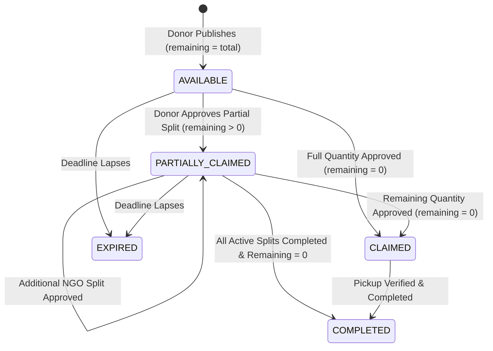

# AnnaDhata System Architecture & Design Documentation

**Smart Food Waste Reduction and Sustainable Redistribution Ecosystem**
*Tagline: "Turning Surplus Food Into Meals, Not Waste."*

---

## 1. High-Level Architectural Overview

AnnaDhata is a decoupled full-stack ecosystem uniting a React 18 TypeScript SPA, a Java 21 Spring Boot 3.2.5 service core, MongoDB persistence, ZXing QR generation, and Google Gemini AI with deterministic safety and mathematical fallbacks.

```mermaid
flowchart TD
    subgraph ClientTier ["React 18 + TypeScript + Vite"]
        UI_DONOR["Donor Portal, Partial Split Tracking & Rescue Relay"]
        UI_RECEIVER["NGO Discovery, Live Leaflet Map & QR Passport"]
        UI_VOLUNTEER["Volunteer Dispatch Portal & QR Verifier"]
        UI_HEATMAP["AI Demand Heatmap & Spatial Analytics"]
        UI_ADMIN["Admin Governance, Verifications & Safety Review"]
    end

    subgraph SecurityLayer ["Spring Security 6 + JJWT"]
        FILTER["JwtAuthenticationFilter (Active/Unlocked Verification)"]
        RBAC["Role RBAC: DONOR / RECEIVER / VOLUNTEER / ADMIN"]
    end

    subgraph ServiceTier ["Spring Boot 3.2.5 Core"]
        SVC_CLAIM["ClaimService (Atomic Partial Allocation)"]
        SVC_PASS["PassportService (HMAC-SHA256 + ZXing QR)"]
        SVC_RELAY["RescueRelayService (60s Missed-Pickup Recovery)"]
        SVC_VOL["VolunteerService (Atomic Dispatch & Delivery)"]
        SVC_TRUST["TrustScoreService (Weighted Behavioral Audit)"]
        SVC_MATCH["MatchingService (4-Factor + Trust Bonus)"]
        SVC_HEAT["HeatmapService (2.2 km Spatial Clustering)"]
        SVC_SAFETY["FoodSafetyService (Deterministic Minimum Floor)"]
    end

    subgraph DataTier ["MongoDB 6.0+ / Embedded mongo-java-server"]
        MONGO[("14 Collections incl. foodPassports, rescueRelayEvents, volunteerProfiles, trustScores")]
    end

    ClientTier -->|REST + JWT| SecurityLayer
    SecurityLayer --> ServiceTier
    ServiceTier --> DataTier
```

---

## 2. Smart Matching Engine (Deterministic Scoring + Trust Bonus + Gemini)

Ranking combines four core deterministic factors with a transparent Trust & Reliability bonus (up to `+5.0` points, capped at `100.0`):

$$\text{Base Score} = (0.30 \times S_{\text{dist}}) + (0.25 \times S_{\text{qty}}) + (0.25 \times S_{\text{urg}}) + (0.20 \times S_{\text{cat}})$$
$$\text{Final Match Score} = \min\left(100.0, \text{Base Score} + \text{Trust Bonus}\right)$$

- **Distance (`30%`):** Haversine great-circle distance on Earth radius $R = 6371\text{ km}$.
- **Capacity & Remaining Quantity (`25%`):** Evaluates NGO capacity against **`remainingQuantity`** (supporting `PARTIALLY_CLAIMED` portions cleanly).
- **Urgency (`25%`):** Based on time remaining until pickup deadline and urgent need flags.
- **Category Compatibility (`20%`):** Aligns surplus category with verified NGO requirement profiles.
- **Rescue Relay Exclusion:** Alternative NGO matching excludes late receivers (`excludedReceiverIds`) when re-dispatching released allocations.

---

## 3. Partial Food Distribution & QR Food Passport Workflow

Upon approval of any partial or full claim, `PassportService` creates an HMAC-SHA256 signed payload and renders a 260x260 Base64 PNG QR image. Verification (`POST /api/passports/verify`) validates signature integrity, expiration, and caller role (`ROLE_DONOR`, `ROLE_VOLUNTEER`, or `ROLE_ADMIN`) before transitioning the claim to `PICKED_UP`.

---

## 4. Rescue Relay & Volunteer Network Loop

1. **Missed Pickup Detection:** Every 60 seconds, `RescueRelayService` scans `APPROVED` claims whose `confirmedPickupTime + graceMinutes` (default 15m) has elapsed without pickup verification (`PICKED_UP`).
2. **Donor-Approved Release:** Donors review `AWAITING_DONOR_APPROVAL` events in `/rescue-relay` and can approve releasing the uncollected quantity back into `remainingQuantity` while optionally extending the pickup deadline and notifying alternative matched NGOs.
3. **Volunteer Courier Dispatch:** Claims marked `volunteerRequested = true` enter the open dispatch pool. Nearby `ROLE_VOLUNTEER` users accept tasks atomically, scan the Donor/NGO QR Passport on pickup, and confirm NGO delivery (`POST /api/volunteers/tasks/{claimId}/deliver`), triggering idempotent per-claim `ImpactRecord` generation.

---

## 5. AI Demand Heatmap Spatial Clustering

`HeatmapService` aggregates real `Donation`, `ReceiverNeed`, and `Claim` documents over configurable windows (`7d`, `30d`, `all`) and category filters:
- Clusters geographically close points within a **2.2 km grid radius**.
- Computes per-zone `surplusKg`, `demandKg`, `fulfilledKg`, `expiredKg`, normalized `demandIntensity` / `surplusIntensity`, `deficitRatio`, and zone label (`HIGH_DEFICIT`, `HIGH_SURPLUS`, `BALANCED`, or `WASTE_HOTSPOT`).
- Produces strategic summary insights via `GeminiAIService` (with deterministic fallback).

---

## 6. Trust & Reliability Score (0–100)

`TrustScoreService` computes transparent, role-specific behavioral reliability scores backed by real MongoDB records:
- **Donors:** Listing fulfillment rate, clean food safety screening record (deductions for `HIGH_RISK` flags), non-cancellation discipline, and verification standing.
- **Receivers (NGOs):** Completion rate, on-time pickup adherence vs Rescue Relay missed pickups, and verified NGO status.
- **Volunteers:** Delivery completion consistency and verified volume delivered (`totalKgTransported`).
- Tiers: `PLATINUM` ($\ge 90$), `GOLD` ($\ge 75$), `SILVER` ($\ge 60$), `NEEDS_IMPROVEMENT` ($< 60$).

---

## 7. Environmental & Social Impact Equations

Recorded idempotently per completed claim in `ImpactService`:
- **Meal Equivalency (UNEP Food Waste Index):** $\lfloor \text{Quantity (kg)} / 0.40 \rfloor$
- **Greenhouse Gas Avoidance (FAO Benchmark):** $\text{Quantity (kg)} \times 2.5\text{ kg CO}_2\text{e}$
- Deterministic minimum food safety floors (`FoodSafetyService` + `GeminiAIService`) ensure hazardous/expired listings can never be downgraded by LLM output.
